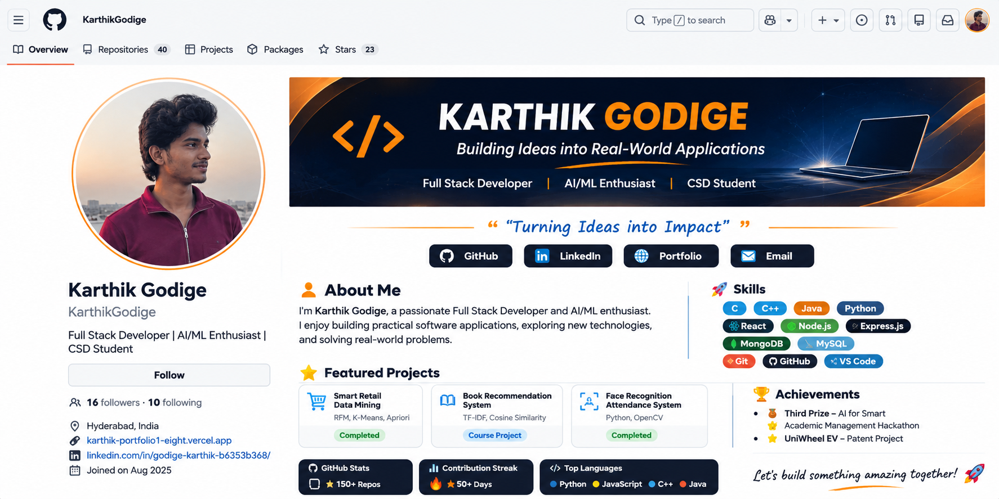

 

  

<h1 align="center">Hi, I'm Karthik Godige 👋</h1>

<h3 align="center">Full Stack Developer | AI/ML Enthusiast | CSD Student</h3>

  <a href="https://github.com/KarthikGodige">GitHub</a> •
  <a href="https://www.linkedin.com/in/godige-karthik-b6353b368/">LinkedIn</a> •
  <a href="https://karthik-portfolio1-eight.vercel.app">Portfolio</a>

---

<table>
<tr>
<td width="65%" valign="top">

## 👨‍💻 About Me

I'm Karthik Godige, a Computer Science and Design student passionate about building practical software applications and exploring emerging technologies.

- 🎓 B.Tech CSD student at Vardhaman College of Engineering
- 💻 Interested in Full Stack Development
- 🤖 Exploring Artificial Intelligence and Machine Learning
- 🧠 Practising Data Structures and Algorithms
- 🚀 Focused on building useful, real-world projects
- 📍 Hyderabad, India

## 🚀 Featured Projects

**1. Smart Retail Data Mining**
- Customer segmentation using RFM and K-Means.
- Market basket analysis using Apriori.
- Python, Pandas, Scikit-learn, Streamlit.

**2. Personalized Book Recommendation System**
- Book recommendations using TF-IDF and cosine similarity.
- Python, Pandas, NLP.

**3. Face Recognition Attendance System**
- Automated attendance using face recognition.
- Python, OpenCV, Flask.

**4. AI for Smart Academic Management**
- Hackathon project focused on improving academic management.

</td>
<td width="35%" valign="top">

## 🛠️ Skills

**Languages**
- C, C++, Java, Python

**Frontend**
- HTML, CSS, JavaScript, React

**Backend**
- Node.js, Express.js

**Databases**
- MongoDB, MySQL, Oracle SQL

**Data & AI**
- NumPy, Pandas, Matplotlib
- Machine Learning, NLP

**Tools**
- Git, GitHub, VS Code

## 🏆 Achievements

- 🥉 Third Prize – AI for Smart Academic Management Hackathon
- 🚲 UniWheel EV – Patent-associated project

## 🎓 Education

**Vardhaman College of Engineering**
B.Tech – Computer Science & Design  
Expected 2028

**Government Polytechnic, Nalgonda**
Diploma – Completed 2025

</td>
</tr>
</table>

---

## 📊 GitHub Statistics

  
  

  

---

  <b>💡 Turning ideas into impact, one project at a time.</b>

  <a href="https://github.com/KarthikGodige">GitHub</a> •
  <a href="https://www.linkedin.com/in/godige-karthik-b6353b368/">LinkedIn</a> •
  <a href="https://karthik-portfolio1-eight.vercel.app">Portfolio</a>

